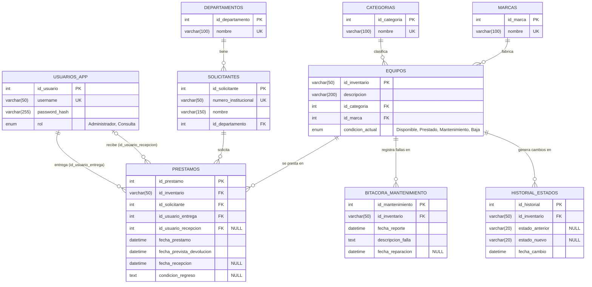

# Sistema de Control de Préstamos de Equipo Tecnológico

**Materia:** Taller de Base de Datos  
**Proyecto Integrador Final — 2026**  
**Alumno:** George Reyes Agustín  
**Grupo:** TBD 08:00 - 09:00  

---

## 1. Propósito de la Aplicación
Esta aplicación web centraliza el registro, seguimiento y control de los préstamos y devoluciones de equipo tecnológico del Departamento de Soporte y Servicios Tecnológicos.

El sistema resuelve problemáticas operativas mediante:
- Identificación de la disponibilidad de los equipos en tiempo real.
- Prevención de préstamos duplicados y bloqueo de entrega de dispositivos que se encuentran en mantenimiento.
- Conservación de la trazabilidad sobre quién tiene un equipo, sus fechas de devolución y su historial de uso.
- Separación de accesos entre los administradores que operan los registros y los usuarios que únicamente consultan la información.

---

## 2. Tecnologías Utilizadas
De acuerdo con los requisitos y el entorno de evaluación del proyecto, el desarrollo emplea:
- **Sistema Operativo:** Linux (Debian 13, 64 bits)
- **Servidor Web:** Apache
- **Backend:** PHP 8.4
- **Base de Datos:** MariaDB 11.8.6
- **Frontend:** HTML, CSS y JavaScript

---

## 3. Modelo de Datos (Avance 1 - DDL)
La base de datos `db_inventario-10` utiliza un modelo relacional normalizado con llaves foráneas configuradas en `ON DELETE RESTRICT` para garantizar la integridad referencial y evitar la pérdida de información en cascada.

### Descripción de Tablas

#### Catálogos
Cuentan con restricciones `UNIQUE` para evitar registros duplicados.
- **`departamentos`**: Almacena las áreas institucionales a las que pertenecen los solicitantes.
- **`categorias`**: Clasifica los tipos de equipo.
- **`marcas`**: Registra los fabricantes de los dispositivos.

#### Entidades Principales
- **`usuarios_app`**: Gestiona las credenciales del personal de soporte, diferenciando entre roles de `Administrador` y `Consulta` para el control de la interfaz web.
- **`solicitantes`**: Contiene los datos del personal institucional que pide equipos, identificados por su número institucional.
- **`equipos`**: Registra cada dispositivo mediante su etiqueta única (`id_inventario`). Su estado controla la lógica del sistema (`Disponible`, `Prestado`, `Mantenimiento`, `Baja`). El estado `Baja` permite retirar un equipo conservando sus movimientos históricos.

#### Operaciones y Auditoría
- **`prestamos`**: Tabla transaccional que vincula el hardware con el solicitante y el personal en turno. Registra las fechas de salida y recepción junto con las condiciones de entrega.
- **`bitacora_mantenimiento`**: Controla las fallas reportadas y los periodos de revisión técnica.
- **`historial_estados`**: Tabla diseñada para registrar los cambios en la condición de los equipos a lo largo del tiempo, operada mediante un trigger.

### Diagrama Entidad-Relación (ERD)



---

## 4. Interfaz Web y Navegación (Avance 2 - Frontend)
La interfaz administrativa está construida con HTML, CSS y JavaScript sin frameworks externos, utilizando un diseño responsivo con menú lateral adaptable a pantallas pequeñas. Todas las pantallas funcionan como páginas dedicadas conectadas mediante parámetros `GET` para facilitar la integración posterior con PHP y MariaDB.

### Módulos Implementados
- **Acceso y Panel Principal (`login.html`, `inicio.html`):** Pantalla de inicio de sesión y vista general con indicadores del inventario y tabla de préstamos activos.
- **Equipos (`equipos/`):** Inventario con búsqueda y filtro por condición. El formulario `registrar.html` se reutiliza tanto para nuevos registros como para edición al recibir el `id_inventario` por URL.
- **Solicitantes (`solicitantes/`):** Directorio filtrable por departamento y búsqueda por nombre o número institucional, con formulario único para altas y edición.
- **Préstamos y Devoluciones (`prestamos/`):** Consulta de préstamos activos, captura de nuevas entregas y recepción de equipo (`devolucion.html`). El flujo de devolución se abre desde la tabla de préstamos activos con el folio correspondiente, muestra en solo lectura al usuario encargado de la entrega y recepción, y permite definir si el equipo regresa a `Disponible` o pasa a `Mantenimiento`.
- **Mantenimiento (`mantenimiento/`):** Bandeja general de `bitacora_mantenimiento` con filtro por estado (`En revisión` / `Cerrado`), reporte manual de fallas (`registrar.html`) y cierre de revisión técnica (`finalizar.html`) para capturar la fecha de reparación y asignar el estado final (`Disponible` o `Baja`). Accesible desde el menú lateral y desde las acciones de cada equipo.
- **Consultas (`consultas/`):** `disponibilidad.html` agrupa las vistas de listado general, equipos disponibles, préstamos activos y vencidos. `historial.html` unifica las consultas por solicitante y por equipo; cuando la búsqueda es por equipo, incluye un segundo panel para mostrar los registros generados por el trigger en `historial_estados`.
- **Catálogos (`catalogos/catalogos.html`):** Concentra en una sola pantalla la administración de `departamentos`, `categorias` y `marcas`.

### Manejo de Roles en la Interfaz
Los perfiles `Administrador` y `Consulta` comparten la misma estructura de pantallas. Al integrar PHP, los controles de registro, edición, devolución, cierre de mantenimiento y el acceso a catálogos se ocultarán automáticamente para las sesiones con rol de solo lectura.

---

## 5. Backend e Integración con MariaDB (Avance 3)
Todas las pantallas estáticas del avance anterior se migraron a PHP 8 y se conectaron a la base de datos `db_inventario-10` utilizando PDO. Para evitar código repetido, la interfaz comparte cabecera, menú lateral, control de sesión y pie de página desde la carpeta `includes/`.

### Conexión, Seguridad y Sesiones
- **Acceso a datos (`includes/config.php`, `includes/conexion.php`):** Conexión mediante PDO con `PDO::ATTR_EMULATE_PREPARES => false`, modo de errores por excepciones y zona horaria ajustada a `America/Mexico_City` para coincidir con el servidor MariaDB. Todas las operaciones que reciben datos del usuario usan consultas parametrizadas.
- **Autenticación y roles (`pages/login.php`, `pages/logout.php`, `includes/auth.php`):** Inicio de sesión validado con `password_verify()` contra los hashes almacenados en `usuarios_app` y regeneración de identificador de sesión al autenticar. La función `requerirAdmin()` bloquea desde el servidor tanto el acceso a formularios como las peticiones `POST` de escritura para usuarios con rol `Consulta`.
- **Cuentas de prueba incluidas:** `admin` / `admin123` (Administrador) y `consulta` / `consulta123` (Consulta).

### Operaciones SQL y Lógica Implementada
- **Panel principal (`pages/inicio.php`):** Muestra los contadores de equipos activos (excluyendo registros en `Baja`) y la tabla de préstamos activos obtenida con `JOIN` entre `prestamos`, `equipos` y `solicitantes`.
- **Equipos, solicitantes y catálogos (`pages/equipos/`, `pages/solicitantes/`, `pages/catalogos/`):** Operaciones `SELECT` con filtros dinámicos, `INSERT`, `UPDATE` (en equipos y solicitantes) y `DELETE`. Los formularios de escritura aplican redirección Post-Redirect-Get (PRG) para evitar reenvíos al recargar, validan la existencia previa del registro y capturan códigos de error de MariaDB (`1062` para duplicados y `1451` para proteger registros con historial bajo `ON DELETE RESTRICT`). En equipos solo se permite cambiar manualmente entre `Disponible` y `Baja`.
- **Préstamos, devoluciones y mantenimiento (`pages/prestamos/`, `pages/mantenimiento/`):** Las operaciones compuestas se ejecutan dentro de transacciones (`beginTransaction`, `commit`, `rollBack`) con bloqueo de fila mediante `SELECT ... FOR UPDATE` para evitar préstamos duplicados o actualizaciones incompletas:
  - Al registrar un préstamo se verifica disponibilidad, se guarda la entrega y el equipo pasa a `Prestado`.
  - Al registrar una devolución se actualiza el préstamo y el equipo pasa a `Disponible` o a `Mantenimiento`; en el segundo caso se inserta automáticamente el reporte en `bitacora_mantenimiento`.
  - Al reportar o finalizar una falla se sincroniza `bitacora_mantenimiento` con la condición del equipo (`Mantenimiento`, `Disponible` o `Baja`).
- **Consultas y reportes (`pages/consultas/`):** `disponibilidad.php` ejecuta las vistas con `JOIN` para listado general, equipos disponibles, préstamos activos y préstamos vencidos, calculando el tiempo exacto de atraso con `TIMESTAMPDIFF(MINUTE, ...)` formateado a minutos, horas o días. `historial.php` consulta préstamos y cambios de estado por equipo o por solicitante, apoyándose en listas `<datalist>` actualizadas dinámicamente desde `js/app.js`.
- **Datos iniciales de prueba (`base_datos.sql`):** Se eliminó `CREATE DATABASE` para ejecutar `USE` directamente sobre la base asignada en el servidor. Se incorporaron catálogos, solicitantes, equipos en todos los estados, préstamos históricos, vigentes y vencidos (con fechas relativas a `NOW()`), bitácora de mantenimiento e historial de estados, dejando registros sin uso para comprobar operaciones `DELETE`. Los objetos programables (procedimiento almacenado, función almacenada y trigger) se integrarán en la entrega final.

---

## 6. Estructura del Repositorio

```text
/
├── index.php
├── base_datos.sql
├── README.md
├── css/
│   └── estilos.css
├── includes/
│   ├── auth.php
│   ├── conexion.php
│   ├── config.php
│   ├── footer.php
│   └── header.php
├── js/
│   └── app.js
└── pages/
    ├── login.php
    ├── logout.php
    ├── inicio.php
    ├── catalogos/
    │   └── catalogos.php
    ├── consultas/
    │   ├── disponibilidad.php
    │   └── historial.php
    ├── equipos/
    │   ├── equipos.php
    │   └── registrar.php
    ├── mantenimiento/
    │   ├── finalizar.php
    │   ├── mantenimiento.php
    │   └── registrar.php
    ├── prestamos/
    │   ├── devolucion.php
    │   ├── prestamos.php
    │   └── registrar.php
    └── solicitantes/
        ├── registrar.php
        └── solicitantes.php
```

- `index.php` — Punto de entrada que redirige a `pages/login.php`.
- `includes/` — Configuración de base de datos, conexión PDO, verificación de sesión/roles y plantillas compartidas de interfaz.
- `pages/` — Módulos PHP funcionales con su lógica de acceso a datos y vistas.
- `css/estilos.css` — Hoja de estilos general y diseño responsivo.
- `js/app.js` — Menú lateral en pantallas pequeñas y cambio de sugerencias de búsqueda en el historial.
- `base_datos.sql` — Script ejecutable con la estructura DDL de `db_inventario-10`, usuarios de acceso y datos iniciales de prueba.
- `README.md` — Documentación acumulada del modelo de datos, frontend y backend.